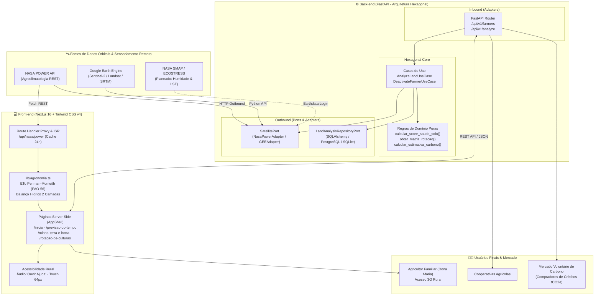

# 🛰️ S.O.L.O. — Smart Observation Land Optimization
### *Campo Amigo: Democratizando a Adaptação Climática e os Créditos de Carbono para a Agricultura Familiar com Dados da NASA*

> **NASA International Space Apps Challenge 2026**  
> **Desafio:** [*Field Shift: Adapting Farms with NASA Data*](https://www.spaceappschallenge.org/2026/challenges/adapting-farms-with-nasa-data/?tab=details)  
> **Repositório:** `QuixindoDev/S.O.L.O` · **Equipa:** S.O.L.O. Team  

---

[](https://www.spaceappschallenge.org/)
[-black?logo=next.js)](front-end/)
[](back-end/)
[](back-end/)
[](front-end/)
[](front-end/)
[-purple)](#-4-arquitetura-do-sistema)
[](NASA-DADOS.md)
[](#-6-créditos-de-carbono--metodologia-científica)

---

## 📑 Índice Geral

1. [Visão Geral do Projeto](#-1-visão-geral-do-projeto)
2. [O Problema vs. A Solução](#-2-o-problema-vs-a-solução)
3. [Principais Funcionalidades](#-3-principais-funcionalidades)
4. [Arquitetura do Sistema](#-4-arquitetura-do-sistema)
5. [Modelos Agronómicos e Dados da NASA](#-5-modelos-agronómicos-e-dados-da-nasa)
6. [Créditos de Carbono & Metodologia Científica](#-6-créditos-de-carbono--metodologia-científica)
7. [Inclusão, Acessibilidade & UX Rural](#-7-inclusão-acessibilidade--ux-rural)
8. [Estrutura do Repositório](#-8-estrutura-do-repositório)
9. [Guia de Instalação e Execução](#-9-guia-de-instalação-e-execução)
10. [Referência dos Endpoints da API](#-10-referência-dos-endpoints-da-api)
11. [Transparência de Dados (Requisito do Júri da NASA)](#-11-transparência-de-dados-requisito-do-júri-da-nasa)
12. [Roadmap & Próximos Passos](#-12-roadmap--próximos-passos)
13. [Documentação Complementar & Links](#-13-documentação-complementar--links)

---

## 🌍 1. Visão Geral do Projeto

O **S.O.L.O.** (*Smart Observation Land Optimization* / *Campo Amigo*) é uma plataforma integrada de suporte à decisão agroecológica e inclusão financeira desenvolvida no âmbito do **NASA International Space Apps Challenge 2026**.

A plataforma conecta **pequenos agricultores familiares** (com foco no contexto de Angola e de comunidades agrícolas vulneráveis do Sul Global) às missões de observação da Terra da NASA (**NASA POWER**, **SMAP**, **ECOSTRESS** e **GPM IMERG**) e ao **Google Earth Engine**. 

O S.O.L.O. cumpre duas missões fundamentais e complementares:
1. **Resiliência e Adaptação Climática no Campo:** Converte telemetria orbital complexa em conselhos diários simples, semáforos visuais intuitivos e orientações por áudio para agricultores idosos (60+ anos, como a persona *Dona Maria*) em conexões 3G rurais, permitindo economizar água, prever estiagens e regenerar o solo com rotação biológica de culturas.
2. **Democratização do Mercado Voluntário de Carbono:** Elimina a barreira de entrada dos pequenos agricultores nas receitas de créditos de carbono ($tCO_2e$), substituindo auditorias laboratoriais tradicionais que custam dezenas de milhares de dólares por monitoramento de sensoriamento remoto gratuito, modelos de balanço hídrico (FAO-56) e cálculos auditáveis segundo os padrões internacionais do IPCC e Verra VM0042.

---

## 🥊 2. O Problema vs. A Solução

```text
┌────────────────────────────────────────────────────────┐
│                      O DESAFIO                         │
│  • Extremos climáticos e secas inviabilizam tradições. │
│  • Terabytes de dados da NASA inacessíveis em HDF5.    │
│  • Pequeno agricultor excluído do mercado de carbono.  │
└──────────────────────────┬─────────────────────────────┘
                           │
                           ▼
┌────────────────────────────────────────────────────────┐
│                   A RESPOSTA S.O.L.O.                  │
│  ✔ Pipeline Server-Side com NASA POWER + GEE           │
│  ✔ Balanço Hídrico FAO-56 + Rotação Regenerativa       │
│  ✔ Certificação orbital de Créditos de Carbono ($USD)  │
│  ✔ Interface Acessível (Áudio, Alto Contraste, 3G)    │
└────────────────────────────────────────────────────────┘
```

| Desafio no Campo | Abordagem Tradicional | Solução S.O.L.O. |
|---|---|---|
| **Incerteza Climática** | O produtor depende de calendários empíricos passados que já não funcionam devido às alterações climáticas. | **Observações de satélite diárias da NASA** indicando temperatura real, precipitação acumulada, radiação e histórico de 7 dias sem falsas promessas. |
| **Abismo de Dados (Data Gap)** | Ficheiros NetCDF, HDF5 e GeoTIFF incompreensíveis para quem cultiva a terra. | **Tradução agronómica imediata**: em vez de `ALLSKY_SFC_SW_DWN = 20.78 MJ/m²`, diz *"O sol esteve forte; o solo está a secar, regue cedo de manhã"*. |
| **Degradação e Monoculturas** | Esgotamento de nitrogénio e perda de matéria orgânica por ciclos sucessivos de milho/mandioca. | **Simulador de Rotação Regenerativa**: Prescreve leguminosas fixadoras (*Vigna unguiculata*, *Arachis hypogaea*, *Cajanus cajan*) que repõem até 80 kg N/ha sem químicos. |
| **Mercado Voluntário de Carbono** | Auditorias in loco com colheita de solo química que custam > \$20.000, inviáveis para quem tem 1 a 10 hectares. | **Algoritmo orbital transparente**: Quantifica o sequestro adicional de carbono ($tCO_2e$) com 20% de margem prudencial e valoriza a \$20/t. |
| **Barreira Geracional e Digital** | Apps com letras miúdas, inglês técnico, botões pequenos e pesadas para 4G/5G. | **UX Rural Inclusiva**: Tipografia legível, botões de 56-64px, sintetizador de voz (*"Ouvir Ajuda"*), SSR com 1 requisição diária que poupa dados móveis. |

---

## 🌟 3. Principais Funcionalidades

### 📱 1. Meu Caderno da Terra (`/inicio`)
* **Dashboard Diário do Agricultor:** Saudação personalizada, resumo meteorológico do dia e semáforo hídrico instantâneo (*Ideal*, *Atenção*, *Seco*).
* **Conselhos Práticos em Linguagem Direta:** Orientações acionáveis do tipo *"Está a chover — não precisa de regar hoje"* ou *"O solo está a secar — regue cedo"*.
* **Acesso Rápido a Tarefas e Canteiros:** Monitorização das parcelas familiares sem atrito cognitivo.

### 🌤️ 2. Previsão e Clima NASA (`/previsao-do-tempo`)
* **Série Agroclimatológica de 7 Dias:** Apresenta os 7 parâmetros essenciais da NASA POWER (`T2M`, `T2M_MAX`, `T2M_MIN`, `PRECTOTCORR`, `RH2M`, `ALLSKY_SFC_SW_DWN`, `WS2M`).
* **Alertas Agroclimáticos:** Identificação de ondas de calor, ventos dessecantes e períodos críticos sem precipitação.
* **Transparência de Satélite:** Exibição clara da data da última passagem orbital da NASA (latência de 2 a 4 dias), respeitando a verdade científica.

### 💧 3. Minha Terra e Horta — Balanço Hídrico (`/minha-terra-e-horta`)
* **Modelo Físico de Duas Camadas:** Estimativa da humidade na camada superficial (0-5 cm) e na zona radicular (30-40 cm).
* **Evapotranspiração de Referência ($ET_0$):** Equação completa de Penman-Monteith (FAO-56) alimentada por dados reais de radiação, vento, temperatura e humidade.
* **Fator de Stress Hídrico ($K_s$):** Simulação da regulação estomática da planta conforme o solo seca, prevenindo colapsos matemáticos irreais.

### 🔄 4. Simulador de Rotação de Culturas (`/rotacao-de-culturas`)
* **Planeamento Safra / Safrinha / Cobertura:** Permite ao agricultor selecionar sequências de culturas e avaliar o impacto antes do plantio.
* **Indicadores em Tempo Real:** Eficiência hídrica (0-100%), regeneração de nitrogénio ($kg\,N/ha$), resiliência a secas e litros de água economizados por metro quadrado.
* **Prescrição Regional para Angola:** Recomendações dinâmicas para solos empobrecidos em zonas do Planalto Central (Huambo, Bié), Norte (Uíge, Malanje) e Semiárido Sul (Cunene, Huíla, Namibe).

### 🌿 5. Minhas Plantas & Calendário (`/minhas-plantas`, `/calendario-de-plantio`)
* **Gestão de Canteiros Familiares:** Acompanhamento do ciclo vegetativo (sementeira, floração, colheita) de culturas hortícolas e grãos.
* **Alertas de Manejo:** Avisos de necessidade de estacas, monda e previsão de dias até à colheita.

### 💰 6. Motor de Créditos de Carbono ($tCO_2e$) & Gestão de Agricultores (`back-end`)
* **Cadastro de Agricultores Familiares:** Registo com suporte a telemóvel para pagamentos móveis (ex: Multicaixa Express, M-Pesa) e vínculo a cooperativas.
* **Diagnóstico de Terreno Automatizado:** Cruzamento de coordenadas geográficas com índices espectrais e dados climáticos de longo prazo.
* **Certificação e Cálculo Financeiro:** Aplicação da fórmula estequiométrica $CO_2/C$ (3.67), retenção prudencial de risco (*buffer pool* de 20%) e monetização em USD.

---

## 🏛️ 4. Arquitetura do Sistema

O projeto é estruturado como um **Monorepo** coeso, dividindo claramente as responsabilidades entre uma interface moderna e acessível em Next.js e um núcleo robusto de regras de negócio em FastAPI baseado em **Arquitetura Hexagonal (Ports & Adapters)**.



### 🧱 Camadas do Back-end Hexagonal (`back-end/`)
* **`src/domain/` (Coração):** Entidades puras (`Agricultor`, `Fazenda`, `AnaliseSolo`, `EstimativaCarbono`) e regras científicas (`rules.py`), sem qualquer dependência de frameworks.
* **`src/application/` (Orquestração):** Casos de uso (`AnalyzeLandUseCase`, `DeactivateFarmerUseCase`) e interfaces abstratas/portas (`SatellitePort`, `LandAnalysisRepositoryPort`).
* **`src/infrastructure/` (Mundo Exterior):** Adaptadores de entrada HTTP (FastAPI, Schemas Pydantic) e adaptadores de saída de persistência (SQLAlchemy, SQLite, PostgreSQL/PostGIS) e satélite (`NasaPowerAdapter`, `GEEAdapter`, `MockGEEAdapter`).

### ⚡ Estratégia de Performance do Front-end (`front-end/`)
* **Server-Side Rendering (SSR) & ISR (`revalidate: 86400`):** As requisições à NASA POWER ocorrem no servidor Node.js com cache diário de 24 horas. O telemóvel da agricultora recebe o HTML pronto e leve, sem gastar plano de dados com re-consultas.
* **Fallback Gracioso:** Se a NASA estiver em manutenção ou inacessível, o cliente (`client.ts`) serve uma estimativa média local coerente e emite um alerta informativo no rodapé.

---

## 🔬 5. Modelos Agronómicos e Dados da NASA

### 5.1 Parâmetros Extraídos da NASA POWER (Agroclimatology)
Acesso via endpoint diário de ponto geográfico: `https://power.larc.nasa.gov/api/temporal/daily/point?community=AG`

| Parâmetro | Nome Técnico | Unidade | Aplicação no S.O.L.O. |
|---|---|---|---|
| `T2M` | Temperatura do Ar a 2m | °C | Monitoramento térmico diário no dashboard |
| `T2M_MAX` / `T2M_MIN` | Temperaturas Máxima e Mínima | °C | Amplitude térmica para cálculo da pressão de vapor e evapotranspiração |
| `PRECTOTCORR` | Precipitação Corrigida | mm/dia | Insumo principal de água no balanço hídrico do solo |
| `RH2M` | Humidade Relativa a 2m | % | Estimativa do défice de pressão de vapor de saturação ($e_s - e_a$) |
| `ALLSKY_SFC_SW_DWN` | Radiação Solar Global | $MJ/m^2/dia$ | Fornece a energia radiativa ($R_s$) motora da evaporação da água |
| `WS2M` | Velocidade do Vento a 2m | m/s | Fator advectivo na equação de Penman-Monteith |

### 5.2 Evapotranspiração de Referência ($ET_0$) — FAO-56 Penman-Monteith
Ficheiro de referência: [`front-end/src/lib/agronomia.ts`](file:///home/eufrasio/NASA/front-end/src/lib/agronomia.ts)

A evapotranspiração de referência ($mm/dia$) é calculada em conformidade com o padrão internacional da FAO:

$$ET_0 = \frac{0.408 \cdot \Delta \cdot (R_n - G) + \gamma \cdot \frac{900}{T + 273} \cdot u_2 \cdot (e_s - e_a)}{\Delta + \gamma \cdot (1 + 0.34 \cdot u_2)}$$

Onde:
* $R_n$ e $G$: Radiação líquida à superfície e fluxo de calor no solo (estimados com base em `ALLSKY_SFC_SW_DWN`).
* $e_s - e_a$: Défice de pressão de vapor calculado via equações de Tetens e humidade relativa (`RH2M`).
* $\Delta$: Declive da curva de pressão de vapor de saturação à temperatura média $T$.
* $\gamma$: Constante psicrométrica ajustada à altitude barométrica da localidade.
* $u_2$: Velocidade do vento a 2 metros (com limite mínimo físico de $0.5\,m/s$ da FAO).

### 5.3 Balanço Hídrico do Solo em 2 Camadas (Modelo de Balde)
O solo é modelado em duas zonas dinâmicas:
1. **Camada Superficial (0 a 5 cm):** Responde rapidamente a chuvas curtas e evaporação direta.
2. **Camada Radicular (30 a 40 cm):** Zona de armazenamento de água para as raízes da cultura.

As propriedades hidráulicas variam segundo a textura do solo configurada:

| Textura do Solo | Capacidade de Campo ($FC$) | Ponto de Murcha ($WP$) | Profundidade Efetiva |
|---|---|---|---|
| **Arenoso** | $0.13\,cm^3/cm^3$ | $0.05\,cm^3/cm^3$ | 30 cm |
| **Franco** | $0.22\,cm^3/cm^3$ | $0.10\,cm^3/cm^3$ | 40 cm |
| **Argiloso** | $0.30\,cm^3/cm^3$ | $0.15\,cm^3/cm^3$ | 40 cm |

**O Papel Decisivo do Coeficiente $K_s$ (Equação 66 do FAO-56):**  
À medida que a humidade $\theta$ desce em direção ao ponto de murcha, as plantas fecham os estomas para reter água. O fator de redução de stress:

$$K_s = \frac{\theta - WP}{FC - WP} \quad (0 \le K_s \le 1)$$

Sem o $K_s$, a evapotranspiração simulada continuaria a ritmo máximo com a terra esturricada, fazendo a humidade colapsar irrealisticamente a zero. Com o $K_s$, o modelo estabiliza num equilíbrio biológico coerente com a observação de campo.

---

## 🌿 6. Créditos de Carbono & Metodologia Científica

Ficheiro de referência: [`back-end/src/domain/rules.py`](file:///home/eufrasio/NASA/back-end/src/domain/rules.py)

O S.O.L.O. quantifica créditos de carbono no solo baseando-se em diretrizes do **IPCC (Tier 1/2)** e metodologias aceites no mercado voluntário (como a **Verra VM0042** — *Methodology for Improved Agricultural Land Management*):

### 6.1 Equação de Quantificação ($tCO_2e$)

$$\text{Créditos Líquidos } (tCO_2e) = \left( \text{Área (ha)} \times \text{Taxa de Sequestro Efetiva} \times 3.67 \right) \times (1 - \text{Margem de Segurança})$$

* **Taxa de Sequestro Efetiva ($tC/ha/ano$):** Adição anual de carbono orgânico no solo promovida pela leguminosa recomendada (ex: $1.25\,tC/ha$ para Feijão-frade).
* **Fator Estequiométrico 3.67 ($44/12$):** Razão molecular de conversão entre o Dióxido de Carbono ($CO_2$) e o Carbono atómico elementar ($C$).
* **Margem de Segurança (*Buffer Pool* de 20%):** Retenção prudencial internacional obrigatória para cobrir riscos de reversão climática (ex: incêndio ou seca extrema) e incertezas estatísticas.
* **Fator de Adicionalidade:** Solos com saúde degradada (score < 40) recebem um multiplicador de adicionalidade de $+15\%$, pois possuem maior capacidade de absorção marginal de biomassa quando recuperados.
* **Valorização Comercial:** $\text{Créditos Líquidos} \times \text{Preço de Mercado}$ (parâmetro padrão da plataforma: $\$20.00 / tCO_2e$).

### 6.2 Matriz de Rotação Agronómica para Angola
O motor prescreve culturas regenerativas adaptadas aos biomas angolanos:

```text
                  ┌───────────────────────────────┐
                  │    Cultura Atual Esgotada     │
                  └──────────────┬────────────────┘
                                 │
         ┌───────────────────────┼────────────────────────┐
         ▼                       ▼                        ▼
       Milho                  Mandioca          Massango / Massambala
   (Score < 50)             (Longo Ciclo)            (Semiárido)
         │                       │                        │
         ▼                       ▼                        ▼
   Feijão-frade          Feijão-frade + Mucuna      Feijão-guandu
(Vigna unguiculata)       (Ciclagem de K & solo)   (Raízes até 2 metros)
Fixação: 80 kg N/ha      Fixação: 100 kg N/ha     Fixação: 100 kg N/ha
Sequestro: +1.25 tC/ha   Sequestro: +1.35 tC/ha   Sequestro: +1.45 tC/ha
```

---

## 👵 7. Inclusão, Acessibilidade & UX Rural

O sistema foi desenhado de raiz pensando no utilizador real do campo:
* **Persona Dona Maria (60+ anos):** Produtora rural em áreas isoladas, com baixa literacia digital, operando sob sol forte e usando telemóveis económicos em redes 3G lentas e instáveis.
* **Componente "Ouvir Ajuda":** Síntese por voz integrada que lê os avisos e previsões em áudio claro com um único clique no topo de qualquer ecrã.
* **Ergonomia Tátil:** Todos os botões principais têm alturas mínimas generosas (**56px** a **64px**) para facilitar o toque por mãos calejadas pelo trabalho agrícola.
* **Tipografia e Contraste Máximo:** Uso da fonte *Atkinson Hyperlegible*, com espaçamento reforçado e conformidade estrita com padrões de alto contraste (WCAG AAA).
* **Navegação Adaptativa:** Barra lateral fixa no desktop que se transforma automaticamente num *drawer* deslizante com botão hamburger intuitivo em smartphones.

---

## 📂 8. Estrutura do Repositório

```text
NASA/
├── README.md                      # Este documento (Visão Geral, Setup & Arquitetura)
├── NASA-DADOS.md                  # Guia Técnico Aprofundado das Missões da NASA
│
├── front-end/                     # Aplicação Next.js 16 (App Router + Tailwind v4)
│   ├── src/
│   │   ├── app/
│   │   │   ├── (app)/             # Rotas autenticadas da aplicação (com Sidebar/TopBar)
│   │   │   │   ├── inicio/        # Ecrã 4: Dashboard "Meu Caderno da Terra"
│   │   │   │   ├── previsao-do-tempo/ # Ecrã 6: Previsão do Tempo (NASA POWER)
│   │   │   │   ├── minha-terra-e-horta/ # Ecrã 7: Balanço Hídrico e Solo
│   │   │   │   ├── minhas-plantas/    # Ecrã 8: Canteiros e Colheita
│   │   │   │   └── rotacao-de-culturas/ # Ecrã 5: Simulador de Rotação Interativo
│   │   │   ├── (auth)/            # Telas de login, SMS e verificação 2FA
│   │   │   ├── api/nasa/power/    # Proxy REST com cache de 24h para NASA POWER
│   │   │   └── layout.tsx         # Layout raiz com fontes e tokens visuais
│   │   ├── components/
│   │   │   ├── layout/            # AppShell, TopBar, Sidebar, navItems
│   │   │   ├── ui/                # Botões (40-64px), Cards, Badges, ScoreRing, Inputs
│   │   │   └── features/          # Componentes de dashboard, clima, terra e plantas
│   │   ├── lib/
│   │   │   ├── agronomia.ts       # Algoritmo de ETo (FAO-56) e balanço de 2 camadas
│   │   │   ├── farm.ts            # Perfil do agricultor e localização padrão
│   │   │   └── nasa/              # Cliente HTTP NASA POWER e normalização de dados
│   │   ├── types/                 # Interfaces TypeScript (nasa.ts, agronomy.ts)
│   │   └── data/                  # Catálogo de culturas (crops.json) e canteiros
│   ├── index.html                 # Apresentação interativa / pitch do projeto
│   ├── package.json               # Dependências do frontend
│   └── tailwind.config.ts         # Configuração de design system e tokens
│
└── back-end/                      # API REST em FastAPI (Arquitetura Hexagonal)
    ├── src/
    │   ├── domain/                # Núcleo de Domínio
    │   │   ├── entities.py        # Entidades: Agricultor, Fazenda, AnaliseSolo, etc.
    │   │   └── rules.py           # Regras agronómicas, rotação e cálculo de carbono
    │   ├── application/           # Casos de Uso e Portas
    │   │   ├── use_cases/         # AnalyzeLandUseCase, DeactivateFarmerUseCase
    │   │   └── ports/             # SatellitePort, LandAnalysisRepositoryPort
    │   └── infrastructure/        # Adaptadores Tecnológicos
    │       ├── inbound/http/      # Rotas FastAPI e Schemas Pydantic
    │       └── outbound/          # Repositórios (SQLAlchemy) e Adaptadores (NASA, GEE)
    ├── tests/                     # Bateria de testes automatizados (pytest)
    ├── main.py                    # Ponto de entrada FastAPI e injeção de dependências
    ├── requirements.txt           # Dependências Python
    └── pytest.ini                 # Configuração do executor de testes
```

---

## 🚀 9. Guia de Instalação e Execução

### Pré-requisitos
* **Node.js:** Versão 18.18+ ou 20+ instalada.
* **Python:** Versão 3.10 ou 3.11 instalada.
* **Git:** Para clonar e gerir branches.

---

### 9.1 Executando o Back-end (FastAPI)

```bash
# 1. Aceder à pasta do backend
cd back-end

# 2. Criar e ativar o ambiente virtual Python
python3 -m venv .venv
source .venv/bin/activate    # No Linux/macOS
# .venv\Scripts\activate     # No Windows

# 3. Instalar as dependências necessárias
pip install -r requirements.txt

# 4. Iniciar o servidor de desenvolvimento
uvicorn main:app --reload --port 8000
```

O backend estará operacional em:
* 📖 **Documentação Interativa Swagger UI:** [`http://localhost:8000/docs`](http://localhost:8000/docs)
* 📑 **Documentação Redoc:** [`http://localhost:8000/redoc`](http://localhost:8000/redoc)
* 🩺 **Health Check:** [`http://localhost:8000/health`](http://localhost:8000/health)

#### Executar os Testes Automatizados do Back-end
```bash
# Dentro da pasta back-end (com o venv ativo):
pytest -v
```

---

### 9.2 Executando o Front-end (Next.js)

```bash
# 1. Aceder à pasta do frontend (noutro terminal)
cd front-end

# 2. Instalar as dependências Node.js
npm install

# 3. Iniciar o servidor de desenvolvimento Next.js
npm run dev
```

A aplicação estará acessível em:
* 🌐 **Aplicação Web:** [`http://localhost:3000`](http://localhost:3000) (redireciona para `/inicio`)
* 🎨 **Design System Showcase:** [`http://localhost:3000/design-system`](http://localhost:3000/design-system)

---

### 9.3 Configuração de Variáveis de Ambiente (`.env`)

#### Back-end (`back-end/.env`):
```ini
# Ativar simulação determinística offline (útil para desenvolvimento sem conexão à NASA)
USE_MOCK_SATELLITE=false

# Google Earth Engine (Opcional - opera via fallback resiliente NASA POWER se não fornecido)
EE_PROJECT_ID=

# Base de Dados (Por padrão usa SQLite local se não especificada string PostgreSQL)
DATABASE_URL=sqlite:///./field_shift.db
```

#### Front-end (`front-end/.env.local`):
```ini
# URL do Back-end FastAPI
NEXT_PUBLIC_API_URL=http://localhost:8000
```

---

## 📡 10. Referência dos Endpoints da API

### Endpoints Principais do Back-end (FastAPI)

| Método | Endpoint | Descrição |
|---|---|---|
| `POST` | `/api/v1/farmers` | Regista um novo agricultor familiar (nome, telefone, cooperativa). |
| `GET` | `/api/v1/farmers` | Lista todos os agricultores familiares ativos com suporte a paginação. |
| `GET` | `/api/v1/farmers/{uuid}` | Obtém a ficha detalhada de um agricultor específico pelo seu UUID. |
| `PATCH`| `/api/v1/farmers/{uuid}/deactivate` | Desativação lógica (*soft delete*) de um agricultor sem perda de histórico. |
| `DELETE`| `/api/v1/farmers/{uuid}` | Alias de conformidade REST para desativação lógica do agricultor. |
| `GET` | `/api/v1/farmers/{uuid}/analyses`| Histórico de diagnósticos e créditos de carbono de um agricultor (1:N). |
| `POST` | `/api/v1/analyze` | Recebe coordenadas, área e cultura; executa satélite e gera créditos $tCO_2e$. |
| `GET` | `/api/v1/analyses` | Lista o histórico geral de análises realizadas na plataforma. |
| `GET` | `/api/v1/analyses/{uuid}` | Recupera o diagnóstico completo e estimativa de carbono por UUID. |
| `GET` | `/api/v1/crops` | Catálogo de culturas angolanas e leguminosas regenerativas com taxas de sequestro. |
| `GET` | `/api/v1/carbon-calculator-info` | Detalhes matemáticos e parâmetros da fórmula de carbono aplicada. |
| `GET` | `/health` | Diagnóstico de integridade da API, base de dados e adaptadores de satélite. |

### Exemplo de Payload para Diagnóstico (`POST /api/v1/analyze`):
```json
{
  "latitude": -12.776,
  "longitude": 15.734,
  "area_hectares": 5.0,
  "cultura_atual": "Milho",
  "nome": "Talhão Esperança - Huambo",
  "localizacao_descricao": "Huambo, Planalto Central, Angola",
  "margem_seguranca": 0.20,
  "preco_carbono_usd": 20.0
}
```

---

## 🛰️ 11. Transparência de Dados (Requisito do Júri da NASA)

O regulamento oficial do **NASA Space Apps Challenge** estabelece como critério de avaliação primordial a **Transparência de Dados (*Data Transparency*)**. No S.O.L.O., assumimos esse compromisso ético e científico em todo o código e na interface:

1. **Estimativa Declarada vs. Medição Direta:**  
   O balanço hídrico do solo é explicitamente identificado como **estimativa baseada em modelo agrometeorológico (FAO-56)** alimentado pela NASA POWER. A interface deixa claro que não é uma sonda física no chão e que a medição direta por micro-ondas orbitais será fornecida pela missão **NASA SMAP**.
2. **Sem Falsas Previsões:**  
   Os satélites de observação da Terra da NASA POWER publicam dados consolidados com um desfasamento natural de **2 a 4 dias**. Em vez de projetar números arbitrários como se fossem previsões milagrosas de amanhã, o ecrã declara honestamente: *"Os últimos 7 dias · Última observação do satélite: 11/11/2026"*.
3. **Filtro Rigoroso de Sentinelas:**  
   Dias sem recolha válida no satélite contêm o valor sentinela `-999.0`. A camada de normalização descarta esses pontos para impedir que distorçam médias e ponham em risco o planeamento do agricultor.
4. **Conservadorismo nos Créditos:**  
   A quantificação de créditos de carbono aplica obrigatoriamente um *buffer pool* prudencial de 20%, garantindo que nenhum crédito seja sobrestimado no mercado internacional.

---

## 🗺️ 12. Roadmap & Próximos Passos

- [x] **Fase 1: Especificação, Arquitetura & Integração NASA POWER** (Concluída).
- [x] **Fase 2: Motor de Rotação Agronómica & Modelagem FAO-56** (Concluída).
- [x] **Fase 3: Quantificação de Carbono & API Hexagonal com UUIDs** (Concluída).
- [ ] **Fase 4: Integração com NASA SMAP (L3/L4) e ECOSTRESS:** Autenticação via Earthdata Login (OAuth2) para incorporar medições diretas de humidade no perfil do solo e stress térmico da copa.
- [ ] **Fase 5: Pagamentos Móveis Automatizados:** Integração de webhooks para distribuição de receitas de carbono diretamente nas carteiras móveis dos agricultores (Multicaixa Express / M-Pesa).
- [ ] **Fase 6: Canal USSD / SMS:** Extensão das recomendações prioritárias para telemóveis analógicos sem acesso à internet.

---

## 📚 13. Documentação Complementar & Links

* 🛰️ **[NASA-DADOS.md](NASA-DADOS.md):** Guia técnico completo da integração com as APIs da NASA, equações detalhadas de Penman-Monteith, radiometria e quirks dos dados.
* 💻 **[front-end/README.md](front-end/README.md):** Documentação completa dos componentes React, Design System, tokens e acessibilidade.
* ⚙️ **[back-end/README.md](back-end/README.md):** Especificação detalhada da Arquitetura Hexagonal, regras de negócio e persistência.
* 🌐 **[front-end/index.html](front-end/index.html):** Protótipo visual interativo e apresentação do desafio para demonstração.
* 📖 **[FAO-56 Irrigation and Drainage Paper](https://www.fao.org/4/x0490e/x0490e00.htm):** *Crop evapotranspiration - Guidelines for computing crop water requirements*.
* 🌐 **[Portal Oficial NASA POWER](https://power.larc.nasa.gov/):** Documentação das APIs de agroclimatologia global.

---

<div align="center">
  <sub>Construído com orgulho para o <b>NASA International Space Apps Challenge 2026</b>.</sub><br/>
  <sub><i>"Transformando dados espaciais em alimento, resiliência e dignidade para quem cultiva a terra."</i></sub>
</div>
