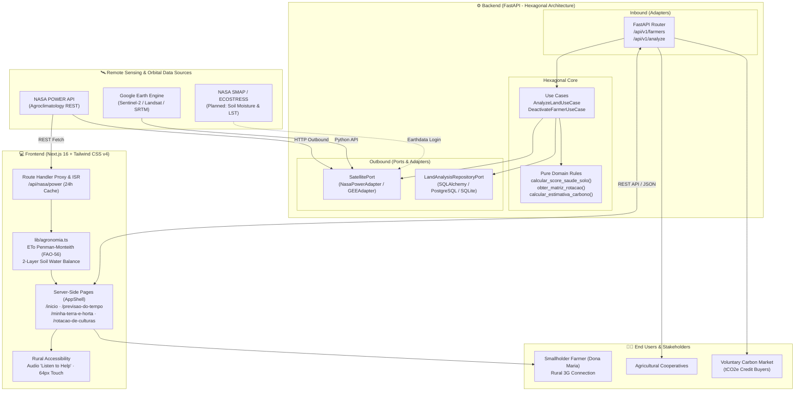

# 🛰️ S.O.L.O. — Smart Observation Land Optimization
### *Field Friend: Democratizing Climate Adaptation and Carbon Credits for Smallholder Farmers using NASA Earth Observation Data*

<<<<<<< HEAD
> **NASA International Space Apps Challenge 2026**  
> **Challenge:** [*Field Shift: Adapting Farms with NASA Data*](https://www.spaceappschallenge.org/2026/challenges/adapting-farms-with-nasa-data/?tab=details)  
> **Live Website:** [*S.O.L.O*](https://www.agrosolo.earth)  
> **Repository:** `QuixindoDev/S.O.L.O` · **Team:** S.O.L.O. Team  
=======
> **NASA International Space Apps Challenge 2026**
> Desafio: *Field Shift: Adapting Farms with NASA Data*
> Repositório: `QuixindoDev/S.O.L.O` · Branch: `requisitos`

Plataforma de suporte à decisão para a **agricultura familiar em Angola**, que traduz dados de satélite da NASA em conselhos simples e visuais para quem tem mais de 60 anos e cultiva a terra.

---

## 🇦🇴 Convenções de localização (pt-Angola)

Todo o conteúdo (design `.pen` e código) segue o **português de Angola**, que segue o Acordo Ortográfico:

| Tema | Termo usado | Não usar |
|---|---|---|
| Humidade do solo | **humidade** | umidade |
| Nutriente | **nitrogénio** | nitrogênio |
| Ecrã | **ecrã** | tela |
| Mercado local | **mercado** | feira livre |
| Moeda | **Kz** (kwanza) | R$ / USD no UI |
| Telefone | **+244 9XX XXX XXX** | (XX) XXXXX-XXXX |
| Stress | **stresse térmico / hídrico** | estresse |

O design de referência é o ficheiro **`login copy.pen`** (pen.dev) — cidade de referência **Caxito - Bengo**, produtor **Dona Maria**, sítio **Sítio Recanto Verde**, agrónoma **Ana**.
>>>>>>> ad8ae9c7 (feat(i18n): localizar design e conteudo para portugues de Angola)

---

[](https://www.spaceappschallenge.org/)
[](https://www.agrosolo.earth)
[-black?logo=next.js)](front-end/)
[](back-end/)
[](back-end/)
[](front-end/)
[](front-end/)
[-purple)](#-4-system-architecture)
[](NASA-DADOS.md)
[](#-6-carbon-credits--scientific-methodology)

<<<<<<< HEAD
---
=======
> **Este é o guia principal para a divisão de tarefas.**
<<<<<<< HEAD
> O design completo das 12 telas está no ficheiro **`login copy.pen`** (pen.dev). Cada ecrã do design corresponde a **uma pasta/rota** indicada na tabela abaixo.
>>>>>>> ad8ae9c7 (feat(i18n): localizar design e conteudo para portugues de Angola)
=======
> O design completo dos 12 ecrãs está no ficheiro **`login copy.pen`** (pen.dev). Cada ecrã do design corresponde a **uma pasta/rota** indicada na tabela abaixo.
>>>>>>> c7ff2d66 (feat(auth): implementa os 4 ecranas de autenticacao do design)

## 📑 Table of Contents

1. [Project Overview](#-1-project-overview)
2. [The Problem vs. The Solution](#-2-the-problem-vs-the-solution)
3. [Core Features](#-3-core-features)
4. [System Architecture](#-4-system-architecture)
5. [Agronomic Models & NASA Data](#-5-agronomic-models--nasa-data)
6. [Carbon Credits & Scientific Methodology](#-6-carbon-credits--scientific-methodology)
7. [Inclusion, Accessibility & Rural UX](#-7-inclusion-accessibility--rural-ux)
8. [Repository Structure](#-8-repository-structure)
9. [Installation & Getting Started Guide](#-9-installation--getting-started-guide)
10. [API Endpoints Reference](#-10-api-endpoints-reference)
11. [Data Transparency (NASA Jury Requirement)](#-11-data-transparency-nasa-jury-requirement)
12. [Roadmap & Next Steps](#-12-roadmap--next-steps)
13. [Complementary Documentation & Links](#-13-complementary-documentation--links)

---

## 🌍 1. Project Overview

**S.O.L.O.** (*Smart Observation Land Optimization* / *Campo Amigo*) is an integrated decision-support and financial inclusion platform built for the **NASA International Space Apps Challenge 2026**.

The platform connects **smallholder family farmers** (with an initial focus on Angola and vulnerable agricultural communities across the Global South) to NASA's Earth Observation missions (**NASA POWER**, **SMAP**, **ECOSTRESS**, and **GPM IMERG**) alongside the **Google Earth Engine**.

S.O.L.O. fulfills two complementary, transformative missions:
1. **Climate Resilience & On-Farm Adaptation:** Translates complex orbital telemetry into simple daily farming advice, intuitive visual traffic lights, and audio guidance tailored for elder farmers (60+ years, such as the *Dona Maria* persona) on limited rural 3G networks. This enables farmers to save irrigation water, anticipate droughts, and regenerate depleted soils via biological crop rotation.
2. **Democratization of the Voluntary Carbon Market:** Eliminates the barrier preventing smallholders from accessing carbon credit revenues ($tCO_2e$). It replaces expensive on-site chemical soil sampling audits (which cost tens of thousands of dollars) with free satellite remote sensing, FAO-56 hydrological water balance modeling, and auditable calculations following international IPCC and Verra VM0042 standards.

---

## 🥊 2. The Problem vs. The Solution

```text
<<<<<<< HEAD
┌────────────────────────────────────────────────────────┐
│                      THE CHALLENGE                     │
│  • Climate extremes and droughts break traditions.     │
│  • Terabytes of NASA data locked in HDF5/NetCDF files. │
│  • Smallholders excluded from the carbon market.       │
└──────────────────────────┬─────────────────────────────┘
                           │
                           ▼
┌────────────────────────────────────────────────────────┐
│                   THE S.O.L.O. ANSWER                  │
│  ✔ Server-side pipeline with NASA POWER + GEE          │
│  ✔ FAO-56 Water Balance + Regenerative Crop Rotation   │
│  ✔ Satellite certification of Carbon Credits ($USD)    │
│  ✔ Accessible UX (Audio Guidance, High Contrast, 3G)   │
└────────────────────────────────────────────────────────┘
=======
src/
├── app/
│   ├── layout.tsx                    # Shell global: fonte Atkinson, metatags, <body>
│   ├── globals.css                   # TOKENS DO DESIGN (fonte de verdade)
│   ├── page.tsx                      # Landing / redirect → /entrar
│   │
│   ├── design-system/page.tsx        # Preview de todos os blocos de ui/
│   │
│   ├── (auth)/                       # Telas SEM barra lateral (login/cadastro)
│   │   ├── layout.tsx                # Top Bar + conteúdo centrado
│   │   ├── criar-conta/page.tsx      # Ecrã 1  — Criar Conta
│   │   ├── entrar/page.tsx           # Ecrã 1B — Entrar
│   │   ├── sms-enviado/page.tsx      # Ecrã 2  — SMS Enviado
│   │   └── verificar/page.tsx        # Ecrã 3  — Código de Segurança (2FA)
│   │
│   ├── (app)/                        # Telas COM barra lateral (a app em si)
│   │   ├── layout.tsx                # AppShell = <Sidebar/> + <TopBar/> + <main/>
│   │   ├── inicio/page.tsx           # Ecrã 4  — Meu Caderno da Terra
│   │   ├── clima/page.tsx            # Ecrã 6  — Previsão do Tempo   (NASA POWER)
│   │   ├── terra/page.tsx            # Ecrã 7  — Minha Terra e Horta (NASA SMAP)
│   │   ├── plantas/page.tsx          # Ecrã 8  — Minhas Plantas
│   │   ├── rotacao/page.tsx          # Ecrã 5  — Rotação de Culturas (SIMULADOR)
│   │   ├── plantio/page.tsx          # Ecrã 10 — Calendário de Plantio
│   │   ├── contas/page.tsx           # Ecrã 9  — Meu Caderninho de Contas
│   │   ├── agronoma/page.tsx         # Ecrã 11 — Falar com a Agrónoma (WhatsApp)
│   │   └── ajuda/page.tsx            # Ecrã 12 — Ouvir Ajuda (áudio)
│   │
│   └── api/
│       └── nasa/
│           ├── power/route.ts        # Proxy + cache 24h para NASA POWER  ← TECH LEAD
│           ├── smap/route.ts         # Humidade do solo (SMAP)            ← TECH LEAD
│           └── ecoStress/route.ts    # Stresse térmico (ECOSTRESS)       ← TECH LEAD
│
├── components/
│   ├── layout/                       # Estrutura da aplicação
│   │   ├── Brand.tsx                 # Logo + "S.O.L.O. / Campo Amigo"
│   │   ├── AuthTopBar.tsx            # Top Bar dos ecrãs de auth (sem sidebar)
│   │   ├── Sidebar.tsx               # Barra lateral (component do design)
│   │   ├── TopBar.tsx                # Cabeçalho com título + "Ouvir Ajuda"
│   │   └── AppShell.tsx              # Junta Sidebar + TopBar + conteúdo
│   │
│   ├── ui/                           # Blocos reutilizáveis (SEM lógica de negócio)
│   │   ├── Button.tsx                # Alturas: sm 40px | md 56px | lg 64px
│   │   ├── Card.tsx                  # Variantes: default | soft
│   │   ├── Field.tsx                 # Label + Input + Texto de ajuda
│   │   ├── Input.tsx                 # Campo de texto 64px
│   │   ├── CodeInputs.tsx            # Os 6 quadradinhos do código SMS
│   │   ├── Callout.tsx               # Aviso | boa notícia | ajuda humana
│   │   └── PhoneNotice.tsx           # "Mensagem enviada para +244 ..."
│   │
│   ├── charts/                       # Gráficos (Recharts)
│   │   ├── WaterBalanceChart.tsx     # Chuva vs. Evapotranspiração
│   │   ├── TemperatureChart.tsx      # Máx/mín + radiação
│   │   └── ChartTooltip.tsx
│   │
│   └── features/                     # Componentes por domínio
│       ├── auth/                     # Ecrãs 1, 1B, 2 e 3
│       │   ├── AuthHero.tsx          # Ícone + título + frase de ajuda
│       │   └── StepRow.tsx           # Passo numerado do guia "passo a passo"
│       ├── dashboard/                # Ecrã 4
│       │   ├── WeatherCard.tsx
│       │   ├── GardenCard.tsx
│       │   ├── TipsGrid.tsx
│       │   └── QuickActions.tsx
│       ├── clima/                    # Ecrã 6
│       │   ├── TodaySummary.tsx
│       │   ├── WeekForecast.tsx
│       │   └── NasaAlerts.tsx
│       ├── terra/                    # Ecrã 7
│       │   ├── SoilGauge.tsx
│       │   ├── PlotCard.tsx
│       │   └── SoilActions.tsx
│       ├── plantas/                  # Ecrã 8
│       │   ├── PlantRow.tsx
│       │   └── HarvestCard.tsx
│       ├── rotacao/                  # Ecrã 5 (core)
│       │   ├── PriorityPicker.tsx    # 4 cartões grandes
│       │   ├── CycleCard.tsx         # 3 cartões de ciclo
│       │   ├── RotationScoreboard.tsx
│       │   └── RotationAdvice.tsx
│       ├── plantio/                  # Ecrã 10
│       │   ├── MonthCard.tsx
│       │   └── TaskList.tsx
│       ├── contas/                   # Ecrã 9
│       │   ├── MoneySummary.tsx
│       │   └── TransactionRow.tsx
│       ├── agronoma/                 # Ecrã 11
│       │   ├── ChatBubble.tsx
│       │   └── QuickQuestions.tsx
│       └── ajuda/                    # Ecrã 12
│           ├── AudioPlayer.tsx
│           ├── ListenSection.tsx
│           └── SpeechPreferences.tsx
│
├── hooks/
│   ├── useNasaAgro.ts                # Consome /api/nasa/power  ← TECH LEAD
│   ├── useSimulator.ts               # Motor de scores da rotação ← TECH LEAD
│   ├── useFarmProfile.ts             # Estado do perfil (localStorage)
│   ├── useSpeech.ts                  # Text-to-Speech (áudio) ← TECH LEAD
│   └── useOffline.ts                 # Cache local para uso sem rede
│
├── lib/
│   ├── nasa/
│   │   ├── client.ts                 # fetch + cache 24h + URL da NASA POWER
│   │   └── normalize.ts              # Converte a resposta crua em AgroSummary
│   ├── agronomia.ts                  # Fórmulas de balanço hídrico, ET0, GDD
│   ├── scores.ts                     # Pesos por prioridade do produtor
│   ├── format.ts                     # Datas, moeda (Kz), números em pt-Angola
│   └── utils.ts                      # cn() — merge de classes Tailwind
│
├── types/
│   ├── agronomy.ts                   # Culturas, solos, biomas, prioridades
│   ├── nasa.ts                       # Contratos das respostas NASA
│   └── ui.ts                         # Props dos componentes de ui/
│
└── data/
    ├── crops.json                    # Matriz agronómica das culturas
    ├── crops.ts                      # crops.json tipado + getCrop()
    ├── biomes.json                   # Chuva de referência por bioma angolano
    └── mock.ts                       # Dados de demonstração (do design .pen)
>>>>>>> c7ff2d66 (feat(auth): implementa os 4 ecranas de autenticacao do design)
```

<<<<<<< HEAD
| Field Challenge | Traditional Approach | The S.O.L.O. Solution |
=======
### Mapa: ecrã do design → ficheiro

| Ecrã (`login copy.pen`) | Rota | Componentes principais |
>>>>>>> ad8ae9c7 (feat(i18n): localizar design e conteudo para portugues de Angola)
|---|---|---|
<<<<<<< HEAD
| **Climate Uncertainty** | Farmers rely on past seasonal memory that fails due to shifting climate patterns and erratic rainfalls. | **Daily NASA satellite observations** tracking surface temperature, accumulated precipitation, radiation, and a real 7-day retrospective series. |
| **The Data Gap** | NetCDF, HDF5, and GeoTIFF scientific files are incomprehensible to non-technical rural producers. | **Direct agronomic translation**: Instead of showing `ALLSKY_SFC_SW_DWN = 20.78 MJ/m²`, S.O.L.O. advises: *"Intense solar radiation today; soil is drying fast, water early in the morning"*. |
| **Soil Degradation & Monocropping** | Continuous maize or cassava monoculture depletes nitrogen, exhausts nutrients, and collapses water retention. | **Regenerative Rotation Simulator**: Recommends nitrogen-fixing legumes (*Vigna unguiculata*, *Arachis hypogaea*, *Cajanus cajan*) that replenish up to 80 kg N/ha without synthetic fertilizers. |
| **Voluntary Carbon Market Access** | On-site soil sampling by international certifiers costs > \$20,000, completely out of reach for 1–10 ha family farms. | **Transparent remote sensing algorithm**: Computes net additional sequestered carbon ($tCO_2e$) with an international 20% risk buffer and values it at \$20/t. |
| **Generational & Digital Divide** | Modern agritech apps use small fonts, dense jargon, tiny touch targets, and require high-speed 4G/5G connections. | **Rural-first Accessible Design**: Atkinson Hyperlegible typography, large 56–64px buttons, one-click voice reader (*"Listen to Help"*), and lightweight SSR pages that save mobile data. |
=======
| 1. Criar Conta | `/criar-conta` | `ui/Field`, `ui/Input`, `ui/Button`, `ui/Callout` |
| 1-B. Entrar | `/entrar` | `ui/Field`, `ui/Input`, `ui/Button`, `ui/Callout` |
| 2. SMS Enviado | `/sms-enviado` | `ui/Card`, `ui/PhoneNotice`, `features/auth/StepRow` |
| 3. Código de Segurança | `/verificar` | `ui/Card`, `ui/CodeInputs`, `ui/Callout` |
| 4. Meu Caderno da Terra | `/inicio` | `features/dashboard/*` |
| 5. Rotação de Culturas | `/rotacao` | `features/rotacao/*` |
| 6. Previsão do Tempo | `/clima` | `features/clima/*`, `charts/*` |
| 7. Minha Terra e Horta | `/terra` | `features/terra/*` |
| 8. Minhas Plantas | `/plantas` | `features/plantas/*` |
| 9. Meu Caderninho | `/contas` | `features/contas/*` |
| 10. Calendário de Plantio | `/plantio` | `features/plantio/*` |
| 11. Falar com a Agrónoma | `/agronoma` | `features/agronoma/*` |
| 12. Ouvir Ajuda | `/ajuda` | `features/ajuda/*` |
>>>>>>> c7ff2d66 (feat(auth): implementa os 4 ecranas de autenticacao do design)

---

## 🌟 3. Core Features

### 📱 1. My Land Notebook (`/inicio`)
* **Daily Farmer Dashboard:** Personalized morning greeting, agroclimatic weather summary, and instant soil moisture indicator (*Ideal*, *Attention*, *Dry*).
* **Clear Natural Language Guidance:** Actionable prompts such as *"It is raining — good news for dry soil, no watering needed today"* or *"Soil is drying out — water early in the morning"*.
* **Quick Access to Plots & Tasks:** Immediate overview of household plots and garden beds without cognitive clutter.

### 🌤️ 2. Weather & NASA Observations (`/previsao-do-tempo`)
* **7-Day Agroclimatology Series:** Delivers the 7 key parameters from NASA POWER (`T2M`, `T2M_MAX`, `T2M_MIN`, `PRECTOTCORR`, `RH2M`, `ALLSKY_SFC_SW_DWN`, `WS2M`).
* **Agroclimatic Risk Alerts:** Detection of heat waves, desiccating winds, and critical dry spells.
* **Satellite Observation Transparency:** Clearly displays the date of NASA's latest satellite pass (2 to 4 days latency), honoring scientific truth over fabricated forecasts.

### 💧 3. My Land and Garden — Soil Water Balance (`/minha-terra-e-horta`)
* **Two-Layer Physical Soil Model:** Hydrological water balance tracking topsoil (0–5 cm) and root zone (30–40 cm) moisture.
* **Reference Evapotranspiration ($ET_0$):** Full Penman-Monteith (FAO-56) equation driven by NASA solar radiation, wind speed, temperature, and atmospheric humidity.
* **Water Stress Factor ($K_s$):** Simulates plant stomatal closure as moisture declines, avoiding unrealistic mathematical drying collapses.

<<<<<<< HEAD
### 🔄 4. Crop Rotation Simulator (`/rotacao-de-culturas`)
* **Multi-Season Planning (Main Crop / Second Season / Cover):** Allows farmers to test crop sequences and view prospective impacts prior to planting.
* **Real-time Agroecological Indicators:** Water efficiency score (0–100%), biological nitrogen balance ($kg\,N/ha$), drought resilience, and estimated water saved ($L/m^2$).
* **Calibrated for Angolan Biomes:** Dynamic prescriptions for depleted soils across the Central Plateau (Huambo, Bié), Northern provinces (Uíge, Malanje), and Semi-Arid South (Cunene, Huíla, Namibe).

### 🌿 5. My Plants & Planting Calendar (`/minhas-plantas`, `/calendario-de-plantio`)
* **Family Garden Bed Tracking:** Tracks vegetative stages (sowing, flowering, maturity, harvesting) for food crops.
* **Cultural Care Reminders:** Alerts for staking, weeding, and countdown of days remaining until harvest.

### 💰 6. Carbon Credits ($tCO_2e$) & Farmer Management (`back-end`)
* **Family Farmer Registry:** Onboards producers with mobile numbers for digital payouts (e.g., Multicaixa Express, M-Pesa) and cooperative affiliations.
* **Automated Land Diagnosis:** Analyzes plot coordinates against long-term remote sensing and agroclimatic metrics.
* **Auditable Carbon Valuation:** Applies the stoichiometric $CO_2/C$ conversion (3.67), international risk buffer retention (20%), and financial valuation in USD.
=======
| # | Tarefa | Onde |
|---|---|---|
| 1 | Blocos base (`ui/`) | `src/components/ui/` |
| 2 | Estrutura (`Sidebar`, `TopBar`, `AppShell`) | `src/components/layout/` |
| 3 | Ecrãs de autenticação (1, 1B, 2, 3) | `src/app/(auth)/` |
| 4 | Dashboard "Meu Caderno da Terra" (4) | `src/app/(app)/inicio/` |
| 5 | Simulador de Rotação (5) | `src/app/(app)/rotacao/` |
| 6 | Previsão do Tempo (6) | `src/app/(app)/clima/` |
| 7 | Terra e Horta (7) | `src/app/(app)/terra/` |
| 8 | Plantas (8) | `src/app/(app)/plantas/` |
| 9 | Caderninho (9) | `src/app/(app)/contas/` |
| 10 | Calendário de Plantio (10) | `src/app/(app)/plantio/` |
| 11 | Chat com a Agrónoma (11) | `src/app/(app)/agronoma/` |
| 12 | Ouvir Ajuda (12) | `src/app/(app)/ajuda/` |
| 13 | Gráficos | `src/components/charts/` |
| 14 | Responsividade mobile (360px → 4K) | transversal |
>>>>>>> c7ff2d66 (feat(auth): implementa os 4 ecranas de autenticacao do design)

> **Estado actual:** ✅ ecrãs **1, 1B, 2 e 3** (autenticação) implementados a partir do
> `login copy.pen`, com os blocos base de `ui/` correspondentes.
> Ver o preview em **`/design-system`** (apenas os blocos usados nestes 4 ecrãs).
> Os restantes ecrãs e o motor de dados NASA continuam por fazer.

---

## 🏛️ 4. System Architecture

The project is structured as a cohesive **Monorepo**, cleanly separating responsibilities between an accessible Next.js frontend and a resilient FastAPI backend adhering strictly to **Hexagonal Architecture (Ports & Adapters)**.



### 🧱 Hexagonal Backend Layers (`back-end/`)
* **`src/domain/` (The Core):** Pure domain entities (`Agricultor`, `Fazenda`, `AnaliseSolo`, `EstimativaCarbono`) and scientific agronomic rules (`rules.py`), completely decoupled from external frameworks.
* **`src/application/` (Orchestration):** Business use cases (`AnalyzeLandUseCase`, `DeactivateFarmerUseCase`) and abstract boundary ports (`SatellitePort`, `LandAnalysisRepositoryPort`).
* **`src/infrastructure/` (The Outer World):** Inbound HTTP routers (FastAPI, Pydantic schemas) and outbound adapters for persistence (SQLAlchemy, SQLite, PostgreSQL/PostGIS) and satellite telemetry (`NasaPowerAdapter`, `GEEAdapter`, `MockGEEAdapter`).

### ⚡ Frontend Performance & Data Strategy (`front-end/`)
* **Server-Side Rendering (SSR) & ISR (`revalidate: 86400`):** Calls to NASA POWER execute server-side on Node.js with a 24-hour cache. The farmer's mobile browser receives ready, lightweight HTML without redundant client data requests.
* **Resilient Fallback:** If the NASA API is temporarily unreachable or undergoing maintenance, `client.ts` gracefully serves a coherent local default and displays a transparent advisory note.

---

## 🔬 5. Agronomic Models & NASA Data

### 5.1 Extracted NASA POWER Parameters (Agroclimatology)
Accessed via the daily point temporal REST endpoint: `https://power.larc.nasa.gov/api/temporal/daily/point?community=AG`

| Parameter | Scientific Name | Unit | Application in S.O.L.O. |
|---|---|---|---|
| `T2M` | Air Temperature at 2m | °C | Daily thermal tracking on dashboard and climate screens |
| `T2M_MAX` / `T2M_MIN` | Maximum & Minimum Temperatures | °C | Thermal amplitude used to compute saturation vapor pressure & evapotranspiration |
| `PRECTOTCORR` | Corrected Daily Precipitation | mm/day | Primary moisture input for the soil water balance |
| `RH2M` | Relative Humidity at 2m | % | Estimation of actual vapor pressure deficit ($e_s - e_a$) |
| `ALLSKY_SFC_SW_DWN` | All-Sky Surface Shortwave Downward Irradiance | $MJ/m^2/day$ | Radiant energy ($R_s$) driving soil moisture evaporation |
| `WS2M` | Wind Speed at 2m | m/s | Advective aerodynamic component in the Penman-Monteith equation |

### 5.2 Reference Evapotranspiration ($ET_0$) — FAO-56 Penman-Monteith
Reference file: [`front-end/src/lib/agronomia.ts`](file:///home/eufrasio/NASA/front-end/src/lib/agronomia.ts)

Reference evapotranspiration ($mm/day$) is computed strictly in compliance with the FAO-56 international standard:

$$ET_0 = \frac{0.408 \cdot \Delta \cdot (R_n - G) + \gamma \cdot \frac{900}{T + 273} \cdot u_2 \cdot (e_s - e_a)}{\Delta + \gamma \cdot (1 + 0.34 \cdot u_2)}$$

Where:
* $R_n$ & $G$: Net surface radiation and soil heat flux density (derived from `ALLSKY_SFC_SW_DWN`).
* $e_s - e_a$: Vapor pressure deficit derived via Tetens formulas and relative humidity (`RH2M`).
* $\Delta$: Slope of saturation vapor pressure curve at mean air temperature $T$.
* $\gamma$: Psychrometric constant adjusted for barometric altitude.
* $u_2$: Wind speed at 2m (enforcing the FAO-56 physical minimum of $0.5\,m/s$).

### 5.3 Two-Layer Soil Water Balance (Bucket Model)
Soil moisture dynamics are tracked across two physiological layers:
1. **Topsoil Layer (0 to 5 cm):** Reacts rapidly to light showers and direct solar evaporation.
2. **Root Zone Layer (30 to 40 cm):** Serves as the reservoir supporting active root uptake.

Hydrological parameters vary by calibrated soil texture:

| Soil Texture | Field Capacity ($FC$) | Wilting Point ($WP$) | Effective Depth |
|---|---|---|---|
| **Sandy (Arenoso)** | $0.13\,cm^3/cm^3$ | $0.05\,cm^3/cm^3$ | 30 cm |
| **Loamy (Franco)** | $0.22\,cm^3/cm^3$ | $0.10\,cm^3/cm^3$ | 40 cm |
| **Clay (Argiloso)** | $0.30\,cm^3/cm^3$ | $0.15\,cm^3/cm^3$ | 40 cm |

**The Critical Role of the Water Stress Coefficient ($K_s$ — FAO-56 Eq. 66):**  
As volumetric moisture $\theta$ approaches the wilting point, plants close their stomata. The stress factor:

$$K_s = \frac{\theta - WP}{FC - WP} \quad (0 \le K_s \le 1)$$

Without $K_s$, simulated evapotranspiration would proceed at maximum velocity even in parched ground, triggering an unrealistic drop to 0% moisture. With $K_s$, the soil settles at a biologically plausible dry equilibrium.

---

## 🌿 6. Carbon Credits & Scientific Methodology

Reference file: [`back-end/src/domain/rules.py`](file:///home/eufrasio/NASA/back-end/src/domain/rules.py)

S.O.L.O. quantifies soil organic carbon enhancement following **IPCC (Tier 1/2)** guidelines and accepted methodologies in the voluntary carbon market (such as **Verra VM0042** — *Methodology for Improved Agricultural Land Management*):

### 6.1 Carbon Quantification Equation ($tCO_2e$)

$$\text{Net Credits } (tCO_2e) = \left( \text{Area (ha)} \times \text{Effective Sequestration Rate} \times 3.67 \right) \times (1 - \text{Safety Buffer})$$

* **Effective Sequestration Rate ($tC/ha/year$):** Annual soil organic carbon accrual induced by the recommended regenerative legume (e.g., $1.25\,tC/ha$ for Cowpea/Feijão-frade).
* **Stoichiometric Conversion 3.67 ($44/12$):** Molecular mass conversion ratio from elemental carbon ($C$) to carbon dioxide equivalent ($CO_2$).
* **Safety Buffer (20% Pool):** Mandatory international prudential reserve covering climate reversal risks (wildfires, severe drought) and measurement uncertainty.
* **Additionality Factor:** Degraded soils (health score < 40) receive a $+15\%$ additionality factor due to higher marginal soil carbon saturation potential upon recovery.
* **Market Valuation:** $\text{Net Credits} \times \text{Market Price}$ (platform default: $\$20.00 / tCO_2e$).

### 6.2 Agronomic Crop Rotation Matrix for Angola
The engine recommends restorative companion and rotation crops suited to local ecosystems:

```text
                  ┌───────────────────────────────┐
                  │      Depleted Base Crop       │
                  └──────────────┬────────────────┘
                                 │
         ┌───────────────────────┼────────────────────────┐
         ▼                       ▼                        ▼
       Maize                  Cassava              Sorghum / Millet
    (Score < 50)           (Long Cycle)              (Semi-Arid)
         │                       │                        │
         ▼                       ▼                        ▼
     Cowpea               Cowpea + Velvet Bean       Pigeon Pea
(Vigna unguiculata)        (Mucuna pruriens)       (Cajanus cajan)
Fixation: 80 kg N/ha      Fixation: 100 kg N/ha    Fixation: 100 kg N/ha
Sequestration: +1.25 tC   Sequestration: +1.35 tC  Sequestration: +1.45 tC
```

---

## 👵 7. Inclusion, Accessibility & Rural UX

S.O.L.O. was designed from the ground up for rural realities:
* **The "Dona Maria" Persona (60+ years):** Elderly smallholder farmer, low digital literacy, operating under direct glare and sunlight, using budget mobile phones over slow 3G networks.
* **"Listen to Help" Audio Guidance:** Built-in voice synthesizer that reads aloud alerts, recommendations, and weather summaries with a single click from the TopBar.
* **Generous Tactile Targets:** All interactive elements feature substantial heights (**56px** to **64px**) to accommodate calloused hands and ease tapping on small touchscreens.
* **Typography & High Contrast:** Utilizes the *Atkinson Hyperlegible* typeface, with wide spacing and full compliance with WCAG AAA high-contrast standards.
* **Adaptive Navigation:** Clean 280px sidebar on desktop that seamlessly transforms into a lightweight mobile drawer accessible via a prominent hamburger button.

---

## 📂 8. Repository Structure

```text
NASA/
├── README.md                      # Master Documentation (Overview, Setup & Architecture)
├── NASA-DADOS.md                  # Deep Technical Guide on NASA Missions & Physics
│
├── front-end/                     # Next.js 16 Web Application (App Router + Tailwind v4)
│   ├── src/
│   │   ├── app/
│   │   │   ├── (app)/             # Authenticated routes (wrapped with AppShell)
│   │   │   │   ├── inicio/        # Screen 4: "My Land Notebook" Dashboard
│   │   │   │   ├── previsao-do-tempo/ # Screen 6: Weather & NASA POWER Climatology
│   │   │   │   ├── minha-terra-e-horta/ # Screen 7: Soil Water Balance & Moisture
│   │   │   │   ├── minhas-plantas/    # Screen 8: Plots & Harvest Tracker
│   │   │   │   └── rotacao-de-culturas/ # Screen 5: Interactive Crop Rotation Simulator
│   │   │   ├── (auth)/            # Onboarding & authentication screens
│   │   │   ├── api/nasa/power/    # Server-side 24h cached proxy for NASA POWER
│   │   │   └── layout.tsx         # Root layout with font definitions and design tokens
│   │   ├── components/
│   │   │   ├── layout/            # AppShell, TopBar, Sidebar, navItems
│   │   │   ├── ui/                # Tactile Buttons (40-64px), Cards, Badges, ScoreRing
│   │   │   └── features/          # Dashboard, weather, soil, and plant components
│   │   ├── lib/
│   │   │   ├── agronomia.ts       # FAO-56 Penman-Monteith & 2-layer soil model
│   │   │   ├── farm.ts            # Active farm profile & geographical coordinates
│   │   │   └── nasa/              # NASA POWER HTTP client & data normalizer
│   │   ├── types/                 # TypeScript interfaces (nasa.ts, agronomy.ts)
│   │   └── data/                  # Crop matrices (crops.json) and garden bed data
│   ├── index.html                 # Interactive pitch presentation & live prototype
│   ├── package.json               # Frontend dependencies
│   └── tailwind.config.ts         # Design tokens, color system, and layout scale
│
└── back-end/                      # REST API in FastAPI (Hexagonal Architecture)
    ├── src/
    │   ├── domain/                # Domain Core
    │   │   ├── entities.py        # Entities: Agricultor, Fazenda, AnaliseSolo, etc.
    │   │   └── rules.py           # Agronomic rules, rotation matrix & carbon formulas
    │   ├── application/           # Use Cases & Boundary Ports
    │   │   ├── use_cases/         # AnalyzeLandUseCase, DeactivateFarmerUseCase
    │   │   └── ports/             # SatellitePort, LandAnalysisRepositoryPort
    │   └── infrastructure/        # Technical Adapters
    │       ├── inbound/http/      # FastAPI Routers & Pydantic Schemas
    │       └── outbound/          # Repositories (SQLAlchemy) & Satellite Adapters
    ├── tests/                     # Automated test suite (pytest)
    ├── main.py                    # Application entrypoint & dependency injection setup
    ├── requirements.txt           # Python dependencies
    └── pytest.ini                 # Pytest runtime configuration
```

---

## 🚀 9. Installation & Getting Started Guide

### Prerequisites
* **Node.js:** Version 18.18+ or 20+ installed.
* **Python:** Version 3.10 or 3.11 installed.
* **Git:** For version control.

---

### 9.1 Running the Backend (FastAPI)

```bash
# 1. Navigate to the backend directory
cd back-end

# 2. Create and activate a Python virtual environment
python3 -m venv .venv
source .venv/bin/activate    # On Linux/macOS
# .venv\Scripts\activate     # On Windows

# 3. Install dependencies
pip install -r requirements.txt

# 4. Start the FastAPI development server
uvicorn main:app --reload --port 8000
```

The backend services will be available at:
* 📖 **Interactive Swagger UI Documentation:** [`http://localhost:8000/docs`](http://localhost:8000/docs)
* 📑 **Redoc Specification:** [`http://localhost:8000/redoc`](http://localhost:8000/redoc)
* 🩺 **Health Check:** [`http://localhost:8000/health`](http://localhost:8000/health)

#### Running Backend Automated Tests
```bash
# Inside the back-end directory with active virtualenv:
pytest -v
```

---

### 9.2 Running the Frontend (Next.js)

<<<<<<< HEAD
```bash
# 1. Navigate to the frontend directory (in a new terminal)
cd front-end

# 2. Install Node.js dependencies
npm install

# 3. Start the Next.js development server
npm run dev
```

The web application will be live at:
* 🌐 **Web Application:** [`http://localhost:3000`](http://localhost:3000) (auto-redirects to `/inicio`)
* 🎨 **Design System Showcase:** [`http://localhost:3000/design-system`](http://localhost:3000/design-system)
=======
| Ficheiro | Conteúdo |
|---|---|
| **`login copy.pen`** | **Design completo dos 12 ecrãs** (pen.dev) — abrir na extensão Pencil |
| `escopo-projecto.md` | Escopo técnico, objectivos e critérios de avaliação da NASA |
| `stitch-design-system-prompt.md` | Especificação original do design system (9 ecrãs) |
| `index.html` | Protótipo funcional original com simulador e catálogo de APIs |
| `README.md` | Este documento |
>>>>>>> ad8ae9c7 (feat(i18n): localizar design e conteudo para portugues de Angola)

---

### 9.3 Environment Variables Configuration (`.env`)

#### Backend (`back-end/.env`):
```ini
# Enable deterministic offline satellite simulation (ideal for offline tests)
USE_MOCK_SATELLITE=false

# Google Earth Engine Project ID (Optional - falls back seamlessly to NASA POWER if omitted)
EE_PROJECT_ID=

# Database Connection (Defaults to local SQLite if PostgreSQL URL is not provided)
DATABASE_URL=sqlite:///./field_shift.db
```

#### Frontend (`front-end/.env.local`):
```ini
# Backend API Base URL
NEXT_PUBLIC_API_URL=http://localhost:8000
```

---

## 📡 10. API Endpoints Reference

### Core Backend Endpoints (FastAPI)

| Method | Endpoint | Description |
|---|---|---|
| `POST` | `/api/v1/farmers` | Registers a new smallholder farmer (name, mobile phone, cooperative). |
| `GET` | `/api/v1/farmers` | Lists registered active farmers with pagination support. |
| `GET` | `/api/v1/farmers/{uuid}` | Retrieves a single farmer's profile by public UUID. |
| `PATCH`| `/api/v1/farmers/{uuid}/deactivate` | Soft-deactivates a farmer preserving data integrity. |
| `DELETE`| `/api/v1/farmers/{uuid}` | REST alias for soft deactivation. |
| `GET` | `/api/v1/farmers/{uuid}/analyses`| Returns historical plot analyses and carbon credits for a farmer (1:N). |
| `POST` | `/api/v1/analyze` | Receives plot coordinates, area, and crop; queries satellites and computes $tCO_2e$. |
| `GET` | `/api/v1/analyses` | Lists the general ledger of historical land diagnoses. |
| `GET` | `/api/v1/analyses/{uuid}` | Retrieves a complete diagnostic report and carbon valuation by UUID. |
| `GET` | `/api/v1/crops` | Catalog of Angolan regional crops and regenerative legumes with sequestration rates. |
| `GET` | `/api/v1/carbon-calculator-info` | In-depth scientific explanation of the carbon calculation methodology. |
| `GET` | `/health` | System health check reporting status of satellite adapters and database. |

### Sample Diagnosis Request Payload (`POST /api/v1/analyze`):
```json
{
  "latitude": -12.776,
  "longitude": 15.734,
  "area_hectares": 5.0,
  "cultura_atual": "Milho",
  "nome": "Talhão Esperança - Huambo",
  "localizacao_descricao": "Huambo, Central Plateau, Angola",
  "margem_seguranca": 0.20,
  "preco_carbono_usd": 20.0
}
```

---

## 🛰️ 11. Data Transparency (NASA Jury Requirement)

The official **NASA Space Apps Challenge** criteria emphasize **Data Transparency** as a core evaluation pillar. S.O.L.O. upholds this scientific and ethical standard throughout its design:

1. **Declared Estimates vs. Direct Measurements:**  
   The soil water balance is explicitly communicated as an **agrometeorological model estimate (FAO-56)** driven by NASA POWER. The interface informs farmers that this is not an in-ground physical probe, and clarifies that direct microwave satellite observations will be provided upon integrating **NASA SMAP**.
2. **No Fabricated Forecasts:**  
   NASA POWER observations arrive with a natural orbital processing latency of **2 to 4 days**. Rather than displaying arbitrary random numbers disguised as miraculous future predictions, S.O.L.O. transparently states: *"Last 7 days · Latest satellite observation: 11/11/2026"*.
3. **Rigorous Sentinel Filtering:**  
   Days without satellite coverage return the sentinel value `-999.0`. The normalization layer discards these sentinel points to ensure they never contaminate running averages or mislead agricultural decisions.
4. **Conservative Carbon Estimates:**  
   Carbon quantification strictly enforces a 20% safety buffer pool, guaranteeing that no credits are overestimated in international markets.

---

## 🗺️ 12. Roadmap & Next Steps

- [x] **Phase 1: Architecture, Specifications & NASA POWER Integration** (Completed).
- [x] **Phase 2: Agronomic Rotation Engine & FAO-56 Hydrological Modeling** (Completed).
- [x] **Phase 3: Carbon Credit Quantification & Hexagonal API with UUIDs** (Completed).
- [ ] **Phase 4: NASA SMAP (L3/L4) & ECOSTRESS Integration:** Implement Earthdata Login (OAuth2) to ingest direct root-zone soil moisture and canopy thermal stress observations.
- [ ] **Phase 5: Automated Mobile Money Disbursements:** Integrate webhooks with regional mobile money providers (Multicaixa Express, M-Pesa) for direct carbon credit payout delivery.
- [ ] **Phase 6: USSD / Interactive SMS Gateway:** Enable feature phone support to reach farmers without smartphones or data connectivity.

---

## 📚 13. Complementary Documentation & Links

* 🛰️ **[NASA-DADOS.md](NASA-DADOS.md):** Deep technical documentation detailing NASA APIs, Penman-Monteith physics, radiometry, and data quirks.
* 💻 **[front-end/README.md](front-end/README.md):** Complete guide to frontend components, Design System tokens, and accessibility patterns.
* ⚙️ **[back-end/README.md](back-end/README.md):** In-depth specification of the Hexagonal Architecture, domain rules, and persistence layer.
* 🌐 **[front-end/index.html](front-end/index.html):** Interactive presentation prototype and challenge pitch deck.
* 📖 **[FAO-56 Irrigation and Drainage Paper](https://www.fao.org/4/x0490e/x0490e00.htm):** *Crop evapotranspiration - Guidelines for computing crop water requirements*.
* 🌐 **[Official NASA POWER Portal](https://power.larc.nasa.gov/):** Global agroclimatology data access and documentation.

---

<div align="center">
  <sub>Proudly built for the <b>NASA International Space Apps Challenge 2026</b>.</sub><br/>
  <sub><i>"Transforming space data into food, climate resilience, and dignity for smallholder farmers."</i></sub>
</div>
